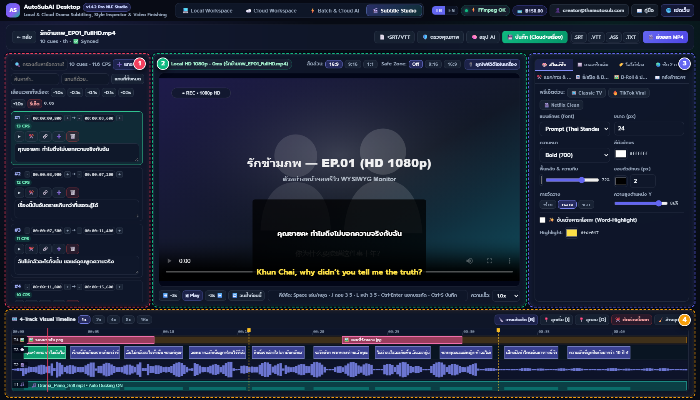

# AutoSubAI Desktop Pro Studio

Native Desktop Pro NLE, AI Voiceover Dubbing, Secretary Meeting Minutes & Drama Subtitling Studio (Tauri v2 + Built-in FFmpeg 6.1.1 + Thai Fonts) for **Windows 10/11**, **macOS (Apple Silicon M1–M4 & Intel)**, and **🐧 Linux x64 (`.AppImage` & `.deb`)** — **100% Local Video Finishing (0% Server Load)** with **🎁 Free 15 mins/week AI Transcription** (≤5 mins/file + ฿10 welcome credit) via [thaiautosub.com](https://www.thaiautosub.com).

---

## ⬇️ Downloads & 📖 Visual User Guide (v1.8.0 Pro Studio)
- **Latest Installers (Windows `.exe`/`.msi`, macOS Apple Silicon & Intel `.dmg`, Linux `.AppImage`/`.deb`)**: **[GitHub Releases (Latest)](https://github.com/ratthanun-hue/AutoSubAI-Desktop/releases/latest)**
- **📖 Visual User Guide — Thai & English (Web + Print PDF)**: **[https://www.thaiautosub.com/guide](https://www.thaiautosub.com/guide)** (`🇹🇭 TH` / [`🇬🇧 EN`](https://www.thaiautosub.com/guide?lang=en))
- **📘 GitHub User Guide**: **[Thai (`docs/USER_GUIDE.md`)](docs/USER_GUIDE.md)** • **[English (`docs/USER_GUIDE_EN.md`)](docs/USER_GUIDE_EN.md)**

---

## ✨ Key Capabilities (`v1.7.2 Pro Studio`)
- **💻 Local Workspace Project (100% Offline & Free)**: Add local HD/4K video/audio & auto-load adjacent `.SRT`/`.VTT` files without login, edit in Subtitle Studio, and export Hardsub/Softsub MP4 with **0% server load**.
- **🎬 Full-Bleed 3-Pane NLE + 5-Track Visual Timeline (`T5`–`T1`)**: Compact Left Subtitle Editor, Wide WYSIWYG Center Monitor, Right 9-Tab Pro Inspector, and Full-Width **5-Track Visual Timeline** (`T5` Watermark/B-Roll, `T4` Draggable Cues, `T3` Voiceover/AI Dubbing, `T2` Original Audio Waveform + Razor Split `[B]`, `T1` BGM + Auto-Ducking, up to `16x` Zoom).
- **🗣️ Free AI Text-to-Voice Dubbing & 🎙️ Live Voiceover (`T3`)**: Generate Thai/Multi-language AI voiceovers (`Edge Neural v2` + automatic `Google Thai TTS` fallback, **0% server load**), **1-Click Auto-Dubbing** from all subtitles with `Auto Time-Fit`, live mic recording, 1-click `▶ ฟัง` clip audition, and `0% / 15% / 50%` original-audio duck presets.
- **🎧 5-Track Independent Audio Monitor (`Solo [S]` / `Mute [M]`)**: Independently solo or mute **`T3 🎙️` Voiceover**, **`T2 🎬` Original Audio**, and **`T1 🎵` BGM** on the 5-Track Toolbar (with live `[S]`/`[M]` badges on Canvas) for preview inspection without altering final MP4 export settings.
- **📝 Secretary Meeting Minutes Mode (`งานประชุม (เลขา)`)**: Record live meetings or import `.m4a`/`.mp3`/Zoom `.mp4`, transcribe + auto-summarize Minutes/Decisions/Action Items, follow along with the **2-Line Rolling Karaoke Stage** & 1-click Speaker Tagger inside a tall 30–40 line transcript editor, and export **Word (`.DOCX` Sarabun)**, **LINE Summary**, **PDF**, or **`.TXT`** in 1 click.
- **✂️ Pro Split, Demux & Multi-Clip Merger**: Razor Split `[B]`, Auto-Split by minutes/equal parts with **Smart Subtitle Snap**, 1–3s **Fast Lossless Split** with per-part timecode-reset `.SRT`, 1-click `.MP3`/`16kHz .WAV`/Mute Demux, Multi-Clip Video+Subtitle Merger & **1-Click 9:16 TikTok/Reels Viral Shorts**.
- **🎨 Subtitle Finishing Suite**: Built-in Thai fonts (`Prompt`, `Kanit`, `Sarabun`), ✨ Kinetic Karaoke Word-Highlight, 🔲 Delogo BoxBlur Bar, 🏷️ Watermark PNG + Channel Intro/Outro Stitch, 🌏 Bilingual Dual-Subtitles & 📖 Series Glossary 1-Click Auto-Fix.
- **🎚️ Color Grading, Speed Control, BGM Auto-Ducking & 📸 1-Click Thumbnail Maker**: Brightness/Contrast/Saturation + 1-Click Presets (`Cinema`, `Vivid HD`, `Warm Drama`), `0.5x–2.0x` Export Speed with automatic Lip-Sync subtitle scaling, FFmpeg `sidechaincompress` **BGM Auto Audio Ducking**, Timed Photo B-Roll on `T5`, and **1920×1080 / 1080×1920** Viral Thumbnail export.
- **☁️ Cloud Workspace, ⚡ Batch Drama Factory & ⬆️ Smart Auto-Updater**: Sync projects with [thaiautosub.com](https://www.thaiautosub.com) (Plan 1 `฿0.069/min`, Plan 2 `฿0.125/min`, Plan 3 `฿0.245/min`), extract 16kHz audio locally (95% smaller upload), batch-render complete episodes, submit feedback via `💬 แนะนำฟีเจอร์`, and receive 1-click updates right inside the app.
