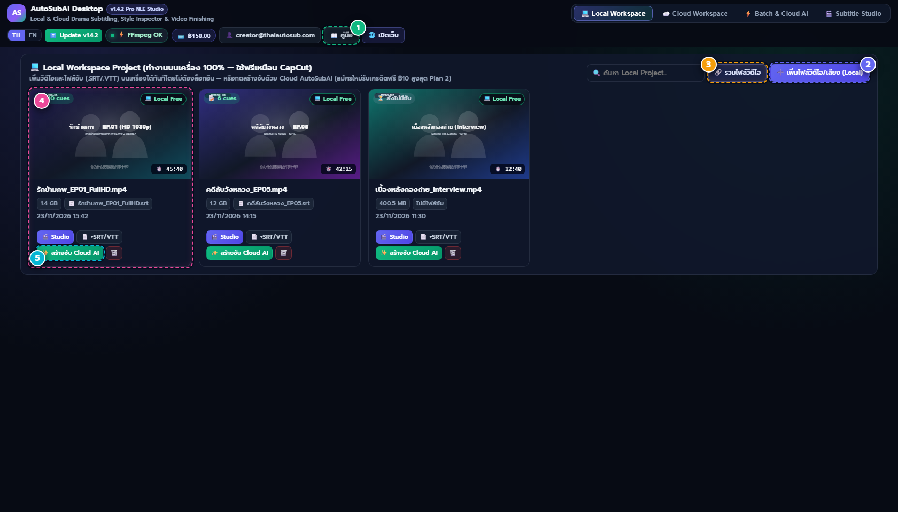
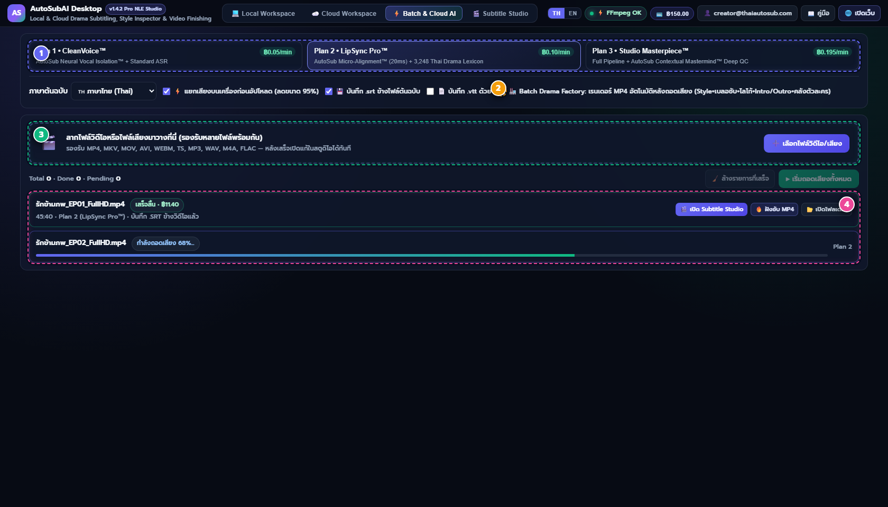
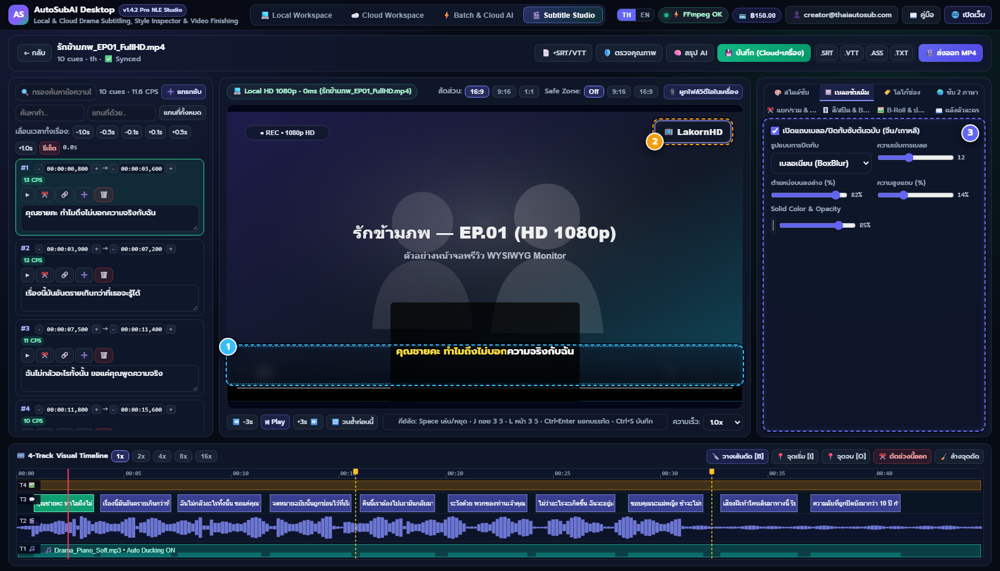
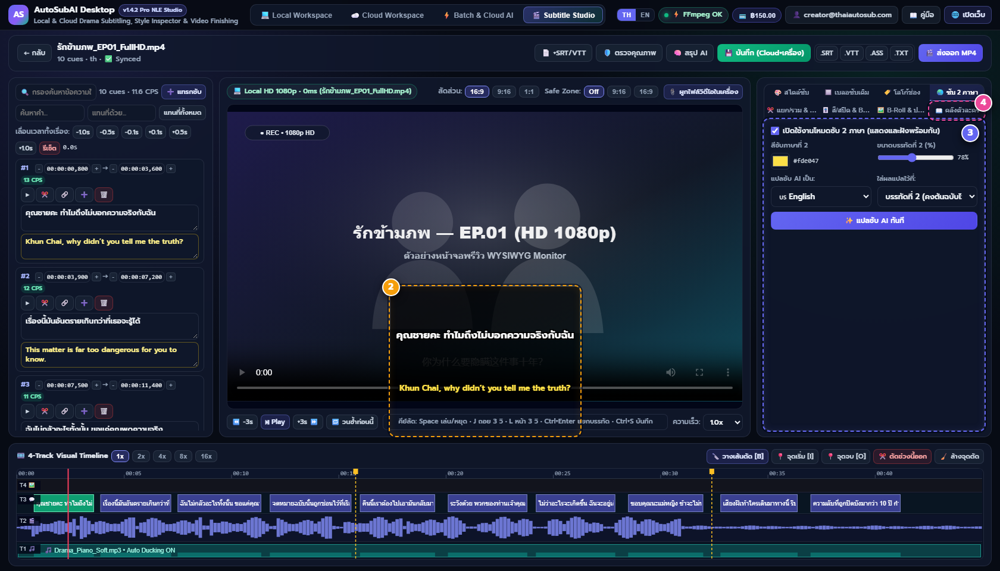
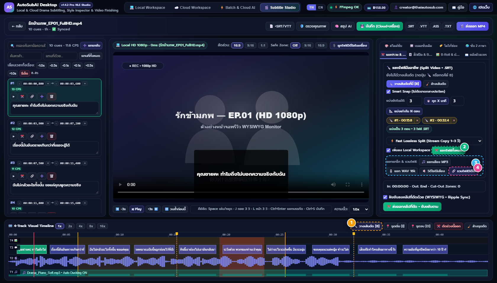

# 📖 คู่มือการใช้งาน AutoSubAI Desktop Pro Studio (v1.4.2)

> 🌐 **อ่านเวอร์ชันเว็บสวยหรู (พร้อมค้นหา & พิมพ์เป็น PDF ได้ใน 1 คลิก)**: **[https://www.thaiautosub.com/guide](https://www.thaiautosub.com/guide)**

**AutoSubAI Desktop Pro Studio** คือโปรแกรมตัดต่อวิดีโอและทำซับไตเติลภาษาไทย-ต่างประเทศแบบครบวงจรบน Windows และ macOS มาพร้อมเอนจิน FFmpeg 6.1.1 และฟอนต์ไทย (`Prompt`, `Kanit`, `Sarabun`) ในตัว ใช้งาน **Local Workspace ฟรี 100% บนเครื่องคุณ (0% โหลดเซิร์ฟเวอร์)** และเชื่อมต่อระบบถอดเสียง AI จาก [thaiautosub.com](https://www.thaiautosub.com) ได้ในคลิกเดียว

---

## สารบัญ
1. [การติดตั้ง & ระบบอัปเดตอัตโนมัติ](#1-การติดตั้ง--ระบบอัปเดตอัตโนมัติ)
2. [Local Workspace (ใช้งานฟรี 100% บนเครื่อง)](#2-local-workspace-ใช้งานฟรี-100-บนเครื่อง)
3. [Batch & Cloud AI — ถอดซับหลายตอน & โหมดโรงงาน](#3-batch--cloud-ai--ถอดซับหลายตอน--โหมดโรงงาน)
4. [โครงสร้างหน้าจอ Pro NLE 3 คอลัมน์ + 4-Track Timeline](#4-โครงสร้างหน้าจอ-pro-nle-3-คอลัมน์--4-track-timeline)
5. [สไตล์ซับ คาราโอเกะ เบลอซับเดิม (Delogo) & โลโก้ช่อง](#5-สไตล์ซับ-คาราโอเกะ-เบลอซับเดิม-delogo--โลโก้ช่อง)
6. [ซับ 2 ภาษา (Bilingual) & คลังตัวละคร (Series Glossary)](#6-ซับ-2-ภาษา-bilingual--คลังตัวละคร-series-glossary)
7. [แยก/รวมไฟล์มืออาชีพ (Razor + Smart Snap) & คลิปสั้น 9:16](#7-แยกรวมไฟล์มืออาชีพ-razor--smart-snap--คลิปสั้น-916)
8. [ปรับสี Color Grading, สปีด 0.5x–2.0x & BGM Auto-Ducking](#8-ปรับสี-color-grading-สปีด-05x20x--bgm-auto-ducking)
9. [Photo B-Roll / PiP, สร้างปกคลิป 1 คลิก & ส่งออก MP4](#9-photo-b-roll--pip-สร้างปกคลิป-1-คลิก--ส่งออก-mp4)
10. [ตารางคีย์ลัดทั้งหมด (Keyboard Shortcuts)](#10-ตารางคีย์ลัดทั้งหมด-keyboard-shortcuts)

---

## 1. การติดตั้ง & ระบบอัปเดตอัตโนมัติ
ดาวน์โหลดตัวติดตั้งเวอร์ชันล่าสุดได้ที่หน้า **[Releases](https://github.com/ratthanun-hue/AutoSubAI-Desktop/releases/latest)**:
- **Windows 10 / 11 (64-bit)**: `AutoSubAI_*_x64-setup.exe` (แนะนำ) หรือ `.msi`
- **macOS Apple Silicon (M1–M4)**: `AutoSubAI_*_aarch64.dmg`
- **macOS Intel (x64)**: `AutoSubAI_*_x64.dmg`

**Smart Auto-Updater**: เมื่อมีเวอร์ชันใหม่ แอปจะแสดงปุ่ม **`⬆️ Update v1.x.x`** บนแถบมุมขวาบนโดยอัตโนมัติ กด 1 คลิกเพื่อดาวน์โหลดและติดตั้งทับได้ทันทีโดยโปรเจกต์เดิมไม่หาย

---

## 2. Local Workspace (ใช้งานฟรี 100% บนเครื่อง)

1. **ปุ่ม `📖 คู่มือ` & แถบสถานะบนสุด**: สลับภาษา `TH/EN`, ตรวจอัปเดต `⬆️ Update`, ดูเครดิต และเปิดคู่มือนี้ได้ทันที
2. **`➕ เพิ่มไฟล์วิดีโอ/เสียง (Local)`**: เพิ่มหรือลากไฟล์มาวางเพื่อสร้างการ์ดโปรเจกต์ 16:9 (ถ้ามีไฟล์ `.SRT`/`.VTT` ชื่อเดียวกันในโฟลเดอร์จะโหลดให้อัตโนมัติ)
3. **`🔗 รวมไฟล์วิดีโอ`**: รวมหลายคลิปเข้าเป็นตอนเดียวพร้อมต่อซับ `.SRT` และบวก Offset เวลาต่อเนื่องอัตโนมัติ
4. **การ์ดโปรเจกต์ 16:9**: คลิกที่รูปปกเพื่อเปิดเข้า **Subtitle Studio** แบบเล่นจากเครื่องลื่น 0ms
5. **`✨ สร้างซับด้วย Cloud AutoSubAI`**: ส่งเฉพาะเสียงขนาดเล็กไปถอดซับ AI และดึง `.SRT` กลับมาเข้าสตูดิโอทันที

---

## 3. Batch & Cloud AI — ถอดซับหลายตอน & โหมดโรงงาน

1. **เลือกแพ็กเกจถอดเสียง (`Plan 1` / `Plan 2` / `Plan 3`)**: เลือกตามงบและความละเอียด (บัญชีสมัครใหม่เครดิตฟรี ฿10 ใช้ได้สูงสุด Plan 2 และปลดล็อก Plan 3 อัตโนมัติเมื่อเติมเครดิต)
2. **🏭 โหมด Batch Drama Factory**: ถอดเสียงเสร็จแล้วให้แอปแก้คำผิดตามคลังตัวละคร + ฝังซับ + เบลอซับเดิม + โลโก้ + ต่อ Intro/Outro เรนเดอร์เป็น MP4 อัตโนมัติบนเครื่องคุณ
3. **พื้นที่ลากไฟล์เข้าคิว**: ลากหลายตอนพร้อมกัน ระบบจะแยกเฉพาะไฟล์เสียง 16kHz บนเครื่องก่อนอัปโหลด (ลดขนาด 95%)
4. **จัดการงานที่เสร็จแล้ว**: เปิดแก้ใน **Subtitle Studio**, ฝังซับ MP4 หรือเปิดโฟลเดอร์ไฟล์ผลลัพธ์ได้ทันที

---

## 4. โครงสร้างหน้าจอ Pro NLE 3 คอลัมน์ + 4-Track Timeline

1. **ซ้าย — แผงซับไตเติลกระชับพอดีคำ**: แก้ซับ, ค้นหา/แทนที่คำ, เลื่อนเวลาทั้งตอน `±0.1s–±1.0s` และดูค่า CPS
2. **กลาง — จอพรีวิว WYSIWYG กว้างเต็มตา**: แสดงผลซับ สี เบลอ โลโก้ B-Roll ตรงกับไฟล์จริง 1:1 สลับสัดส่วน `16:9 / 9:16 / 1:1` + Safe Zone
3. **ขวา — 8-Tab Pro Inspector**: แผงเครื่องมือครบ 8 แท็บวางข้างจอวิดีโอ ปรับแล้วเห็นผลทันทีไม่ต้องเลื่อนจอ
4. **ล่าง — 4-Track Visual Timeline เต็มความกว้าง 100%**:
   - **T4**: โลโก้ช่อง & รูปภาพ Photo B-Roll
   - **T3**: บล็อกซับไตเติล (ใช้เมาส์ลากขอบซ้าย-ขวาจูนเวลาได้โดยตรง!)
   - **T2**: คลื่นเสียง Audio Waveform + ช่วงตัดทิ้ง + จุด `[I]`/`[O]` + เส้นตัดทอง `[B]`
   - **T1**: แทร็กเพลงพื้นหลัง BGM + กราฟ Auto Audio Ducking (ซูมได้สูงสุด `16x`)

---

## 5. สไตล์ซับ คาราโอเกะ เบลอซับเดิม (Delogo) & โลโก้ช่อง

1. **🔲 แถบเบลอซับเดิม (Delogo BoxBlur)**: ปิดทับซับจีน/เกาหลีฝังเดิมได้ทั้งแบบเบลอเนียนหรือแถบสีทึบ ปรับตำแหน่ง Y และความสูงแบบเรียลไทม์
2. **🏷️ โลโก้ช่อง (Watermark PNG) & Intro/Outro**: วางโลโก้ PNG ได้ทั้ง 4 มุม และต่อคลิปหัว-ท้ายช่องอัตโนมัติตอน Export
3. **🎨 สไตล์ซับ & ✨ คาราโอเกะ**: เลือกฟอนต์ไทย `Prompt/Kanit/Sarabun`, พรีเซ็ต 1 คลิก (`Classic TV`, `TikTok Viral`, `Netflix Clean`) และเปิดซับเด้งคาราโอเกะไฮไลต์สีตามคำพูด

---

## 6. ซับ 2 ภาษา (Bilingual) & คลังตัวละคร (Series Glossary)

1. **กล่องซับคู่ (ซับหลัก + ซับรอง)**: แก้ไขภาษาหลักและภาษารองพร้อมกันทุกบรรทัด
2. **พรีวิวซับ 2 ภาษาสดบนจอ**: ปรับขนาดและสีซับรองแยกจากซับหลักได้อิสระ
3. **แปลซับทั้งเรื่องใน 1 คลิก**: เลือกภาษาปลายทางแล้วแปลเป็นชุดความเร็วสูงจากเครื่องคุณโดยตรง
4. **📖 คลังตัวละคร (Series Glossary)**: บันทึกกฎแก้คำเฉพาะประจำเรื่อง เช่น `ท่านออง → ท่านอ๋อง` แล้วกด **Auto-Fix ทั้งตอน** ใช้ซ้ำได้ทุกตอน

---

## 7. แยก/รวมไฟล์มืออาชีพ (Razor + Smart Snap) & คลิปสั้น 9:16

1. **🔪 วางเส้นตัด Razor Split `[B]` + Smart Snap**: ปักจุดตัดด้วยปุ่มหรือคีย์ `B` หรือแบ่งอัตโนมัติทุก X นาที / N ตอน พร้อม Smart Snap ไม่ตัดขาดกลางประโยค
2. **⚡ แยกไฟล์ไว (Fast Lossless Split)**: ส่งออกเป็น `Part_01..N.mp4` + `.SRT` (รีเซ็ตเวลาเริ่ม `00:00:00` ทุกตอน) เสร็จใน 1–3 วินาที
3. **🎵 แยกเสียง / วิดีโอไร้เสียง (Demux)**: แยก `.MP3`, `16kHz .WAV` หรือวิดีโอปิดเสียงใน 1 คลิก
4. **🔗 รวมไฟล์วิดีโอ & 📱 9:16 TikTok/Reels**: รวมหลายคลิปพร้อมต่อซับ `.SRT` หรือตัดคลิปสั้นแนวตั้ง `1080×1920` พร้อมพาดหัวไทยพื้นหลังเบลอ

---

## 8. ปรับสี Color Grading, สปีด 0.5x–2.0x & BGM Auto-Ducking

1. **🎨 Color Grading**: ปรับ Brightness / Contrast / Saturation หรือใช้พรีเซ็ต 1 คลิก (`Cinema`, `Vivid HD`, `Warm Drama`)
2. **⚡ ความเร็วส่งออก `0.5x–2.0x`**: เร่งสปีดหรือสโลว์โมชันพร้อมสเกลเวลาซับ Lip-Sync อัตโนมัติ
3. **🎵 BGM Mixer & 🤖 Auto Audio Ducking**: ใส่เพลงพื้นหลัง `.MP3`/`.WAV` (วนลูปอัตโนมัติ) พร้อมระบบ `sidechaincompress` ลดเสียงเพลงอัตโนมัติเมื่อตัวละครพูด
4. **แสดงกราฟ Auto-Ducking บนแทร็ก `T1`**: มองเห็นช่วงที่เพลงถูกกดเบาลงใต้ทุกบล็อกซับพูด

---

## 9. Photo B-Roll / PiP, สร้างปกคลิป 1 คลิก & ส่งออก MP4

1. **🖼️ แทรกรูปภาพ Photo B-Roll / PiP**: วางรูปประกอบตามเวลา Playhead (`มุมขวาบน`, `มุมซ้ายบน`, `กลางจอ`, `เต็มจอ`) แสดงแถบสีชมพูบนแทร็ก `T4`
2. **👁️ พรีวิวปกคลิปสดบนจอ Monitor**: พิมพ์พาดหัวหลัก-รอง เลือกฟอนต์ไทยและสีเพื่อเช็กองค์ประกอบภาพแบบสดๆ
3. **📸 ส่งออกภาพปก 1 คลิก**: ส่งออกเป็น **1920×1080 (YouTube)** หรือ **1080×1920 (TikTok/Reels)** ไฟล์ `.JPG` หรือ `.PNG`
4. **🎬 ส่งออก MP4**: เลือก **Hardsub MP4** (ฝังทุกเอฟเฟกต์ครบ) หรือ **Softsub MP4** (เสร็จใน 1–2 วิ) ฟรี 100% บนเครื่องคุณ

---

## 10. ตารางคีย์ลัดทั้งหมด (Keyboard Shortcuts)

| คีย์ลัด | การทำงาน |
| :--- | :--- |
| `Space` | เล่น / หยุดวิดีโอชั่วคราว |
| `J` / `L` | กรอถอยหลัง 3 วิ / กรอเดินหน้า 3 วิ |
| `B` | วางเส้นตัด **Razor Split Marker** ณ ตำแหน่ง Playhead |
| `I` / `O` | กำหนดจุดเริ่ม (In) / จุดจบ (Out) บนไทม์ไลน์ |
| `Ctrl + Enter` | แยกบรรทัดซับที่กำลังแก้ไขเป็น 2 คิว |
| `Ctrl + S` | บันทึกซับทันที (Cloud + ไฟล์ `.SRT` ในเครื่อง) |
