# 📖 AutoSubAI Desktop Pro Studio — User Guide (v1.10.2)

> 🌐 **Read the Interactive Web Guide (TH / EN switcher + 1-Click PDF Print)**: **[https://www.thaiautosub.com/guide?lang=en](https://www.thaiautosub.com/guide?lang=en)**  
> 🆓 **Free Unlimited Offline Speech-to-Text Overview**: **[https://www.thaiautosub.com/offline-speech-to-text-thai](https://www.thaiautosub.com/offline-speech-to-text-thai)**  
> 🇹🇭 **อ่านคู่มือฉบับภาษาไทย**: **[docs/USER_GUIDE.md](USER_GUIDE.md)**

**AutoSubAI Desktop Pro Studio** is an all-in-one desktop **🆓 Free Unlimited Offline Speech-to-Text & Auto-Subtitle (Built-in Model — 0 Credits)**, video editor, AI voiceover dubbing studio, drama subtitling suite, and confidential secretary meeting minutes app for **Windows (Vulkan GPU)**, **macOS (Apple Silicon Metal GPU & Intel)**, and **Linux** — with full **English (`EN`) & Thai (`TH`) UI support**, built-in FFmpeg 6.1.1, and embedded fonts. Enjoy **100% Free Unlimited Offline Transcription + Local Video Finishing & AI Voiceover (0% Server Load)** plus **🎁 15 Free Cloud AI Mins/Week (Max 5 mins/file) + ฿10 Welcome Credit** via [thaiautosub.com](https://www.thaiautosub.com).

---

## Table of Contents
1. [Download, Install & 2-Layer Instant Auto-Updater](#1-download-install--2-layer-instant-auto-updater)
2. [Local Workspace (100% Free & Offline)](#2-local-workspace-100-free--offline)
3. [🆓 Free Unlimited Offline Transcription (Built-in Model) & Batch Cloud AI](#3--free-unlimited-offline-transcription-built-in-model--batch-cloud-ai)
4. [Full-Bleed 3-Pane NLE & 5-Track Visual Timeline](#4-full-bleed-3-pane-nle--5-track-visual-timeline)
5. [Subtitle Styles, Karaoke, Delogo Blur & Channel Watermark](#5-subtitle-styles-karaoke-delogo-blur--channel-watermark)
6. [Bilingual Dual-Subtitles & Series Glossary](#6-bilingual-dual-subtitles--series-glossary)
7. [Pro Split / Merge (Razor + Smart Snap), Demux & 9:16 Viral Shorts](#7-pro-split--merge-razor--smart-snap-demux--916-viral-shorts)
8. [Color Grading, 0.5x–2.0x Speed & BGM Auto Audio Ducking](#8-color-grading-05x20x-speed--bgm-auto-audio-ducking)
9. [🎙️ Live Voiceover, 🗣️ Free AI Text-to-Voice Dubbing & 🎧 T3/T2/T1 Solo/Mute](#9-live-voiceover-free-ai-text-to-voice-dubbing--t3t2t1-solomute)
10. [📝 Meeting Minutes (Secretary Mode) — 100% Offline Built-in Confidentiality & Word/LINE Export](#10-meeting-minutes-secretary-mode--100-offline-built-in-confidentiality--wordline-export)
11. [Photo B-Roll / PiP, 1-Click Viral Thumbnail Maker & MP4 Export](#11-photo-b-roll--pip-1-click-viral-thumbnail-maker--mp4-export)
12. [Keyboard Shortcuts](#12-keyboard-shortcuts)

---

## 1. Download, Install & 2-Layer Instant Auto-Updater
Download the latest All-in-One installer from **[GitHub Releases](https://github.com/ratthanun-hue/AutoSubAI-Desktop/releases/latest)**:
- **🪟 Windows 10 / 11 (64-bit)**: `AutoSubAI_*_x64-setup.exe` (Recommended — **Vulkan GPU** for NVIDIA/AMD/Intel + automatic CPU fallback) or `.msi`
- **🍎 macOS Apple Silicon (M1–M4)**: `AutoSubAI_*_aarch64.dmg` (native **Metal GPU** acceleration)
- **💻 macOS Intel (x64)**: `AutoSubAI_*_x64.dmg`
- **🐧 Linux Desktop (x64)**: `AutoSubAI_*_amd64.AppImage` (Universal) or `AutoSubAI_*_amd64.deb` (Ubuntu / Debian)

**Hybrid 2-Layer Auto-Updater (`< 1s`)**: UI updates arrive via **Ed25519 Signed UI Hot-Patches** (`⚡ Update UI` in `< 1s` without reinstalling), while native engine updates appear via the green **`⬆️ Update v1.x.x`** button without losing local projects. Use **`💬 Feedback`** anytime to request features or report issues.

---

## 2. Local Workspace (100% Free & Offline)

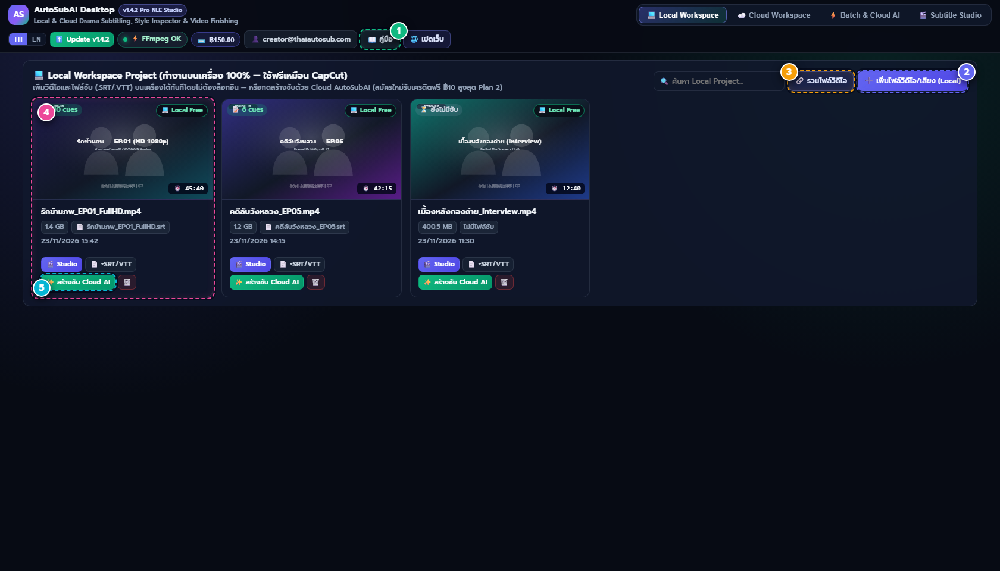

1. **5 Primary Tabs + Language Switcher (`TH / EN`)**: Switch between `💻 Local Workspace`, `📝 Meeting Minutes`, `☁️ Cloud Workspace`, `⚡ Batch & Cloud AI`, and `🎬 Subtitle Studio`. See your live **`🎁 Free 15m/wk`** quota pill in the top bar.
2. **`➕ Add Local Media`**: Import or drag & drop local videos/audio (`MP4, MKV, MOV, AVI, MP3, WAV`). Adjacent `.SRT`/`.VTT` files in the same folder load automatically.
3. **`🔗 Merge Videos`**: Combine multiple clips into one video with automatic continuous `.SRT` subtitle stitching.
4. **16:9 Project Cards**: Click any card to open **Subtitle Studio** with 0ms local playback & scrubbing.
5. **`✨ Cloud AI Subtitles`**: Run AI transcription directly from Local Workspace or from the Subtitle Studio top bar.

---

## 3. 🆓 Free Unlimited Offline Transcription (Built-in Model) & Batch Cloud AI

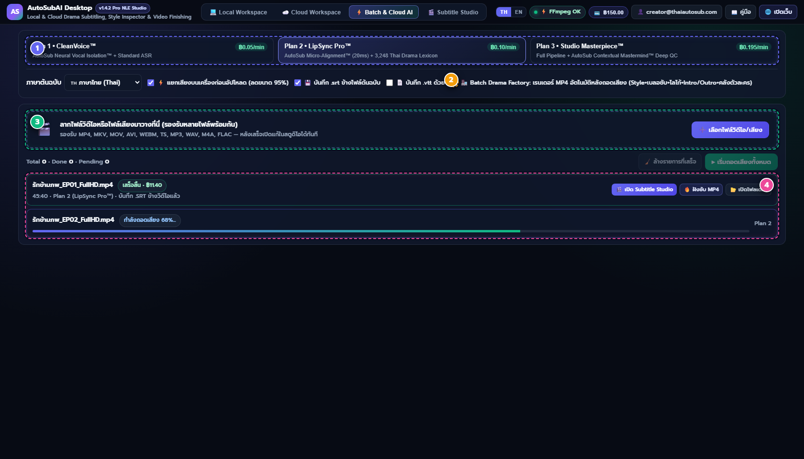

### 🆓 Free Version — 0 Credits (100% Local Built-in Offline Model)
Transcribe audio/video and generate `.SRT` / `.VTT` subtitles right on your computer — **Free Forever, Unlimited Files, 0% Cloud Upload**, with automatic saving into **`💻 Local Workspace`**:
1. **Sign in free (1 click)** with Google or Email to unlock the Built-in model for your account tier.
2. Select **`🆓 Free Version — 0 Credits`** and click **`⬇️ Install Built-in Model`** once right inside the card (once ready it shows **`(Model Installed)`** and works 100% offline anytime).
3. Drop as many video/audio files as you want and click start — hardware-accelerated with **Vulkan GPU (Windows)** / **Metal GPU (macOS)** and automatic CPU fallback.

| Account Tier | Built-in Offline Model | File Count | Max Duration / File | Credits |
| :--- | :--- | :--- | :--- | :--- |
| **Free / Pay-As-You-Go** | Standard Built-in Model | **Unlimited Files** | Up to **60 mins / file** | **฿0 (Free Forever)** |
| **Creator (`฿490/mo`)** | High-Speed Turbo Built-in Model | **Unlimited Files** | Up to **180 mins / file** | **Included** |
| **Pro (`฿990/mo`)** | Maximum-Accuracy Built-in Model | **Unlimited Files** | Up to **180 mins / file** | **Included** |

### ⚡ Cloud AI Plans (`Plan 1` / `Plan 2` / `Plan 3`) — Studio-Grade Accuracy
1. **Choose Cloud AI Plan**:
   - **Plan 1 (`CleanVoice™`)**: **🎁 Free 15 mins/week** (max 5 mins/file, auto-resets every 7 days) or **`฿0.069/min`**
   - **Plan 2 (`LipSync Pro™` — Recommended)**: **`฿0.125/min`** — 20ms lip-sync alignment + Thai/English intelligence
   - **Plan 3 (`Studio Masterpiece™`)**: **`฿0.245/min`** — Deep contextual QC (unlocks automatically after real credit top-up)
2. **🏭 Batch Drama Factory Mode**: Auto-apply Series Glossary + Style + Delogo Blur + Watermark + Intro/Outro into finished MP4s right after transcription completes.
3. **Local Audio Extraction**: Extracts compact 16kHz audio on your computer before upload (**95% smaller** upload size).

---

## 4. Full-Bleed 3-Pane NLE & 5-Track Visual Timeline

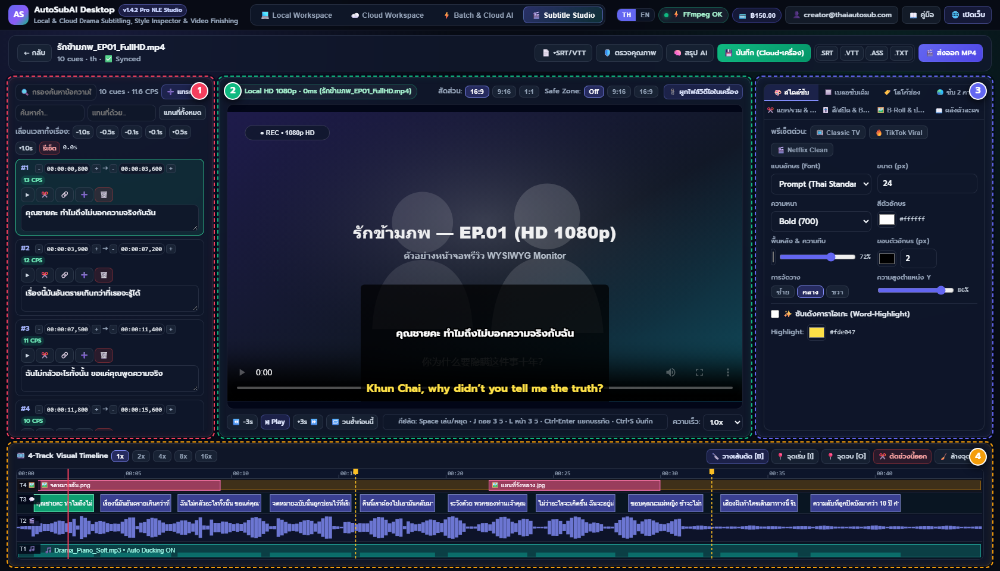

1. **Left — Subtitle Editor**: Edit text, search & replace, bulk-shift timecodes (`±0.1s–±1.0s`), and monitor CPS reading speed.
2. **Center — WYSIWYG Video Monitor**: Real-time 1:1 preview of captions, color grading, delogo blur, logo, and B-Roll with `16:9 / 9:16 / 1:1` and Safe Zone guides.
3. **Right — 9-Tab Pro Inspector**: Every finishing tool — including the dedicated **`🎙️ Voiceover`** AI dubbing tab — right beside your monitor.
4. **Bottom — 5-Track Visual Timeline (`100%` Width, up to `16x` Zoom)**:
   - **T5 🖼️**: Channel Watermark & Photo B-Roll overlays
   - **T4 💬**: Draggable subtitle cue blocks
   - **T3 🎙️**: Live Mic & **Free AI Voiceover** clips (draggable)
   - **T2 🎬**: **Video Filmstrip Snapshots** (1-click toggle) + original audio waveform + Cut Zones + `[I]`/`[O]` + Golden Razor Split `[B]`
   - **T1 🎵**: Background Music (BGM) + Auto Audio Ducking dip curves

---

## 5. Subtitle Styles, Karaoke, Delogo Blur & Channel Watermark

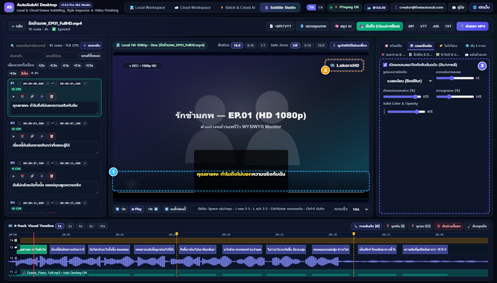

- **🔲 Delogo BoxBlur Bar**: Smoothly blur or mask hardcoded foreign subtitles with real-time Y/height controls.
- **🏷️ PNG Channel Watermark & Intro/Outro**: Place transparent PNG logos in any corner and auto-stitch Intro/Outro clips on export.
- **🎨 1-Click Presets & ✨ Kinetic Karaoke**: Apply `Classic TV`, `TikTok Viral`, or `Netflix Clean` and enable word-by-word karaoke highlights.

---

## 6. Bilingual Dual-Subtitles & Series Glossary

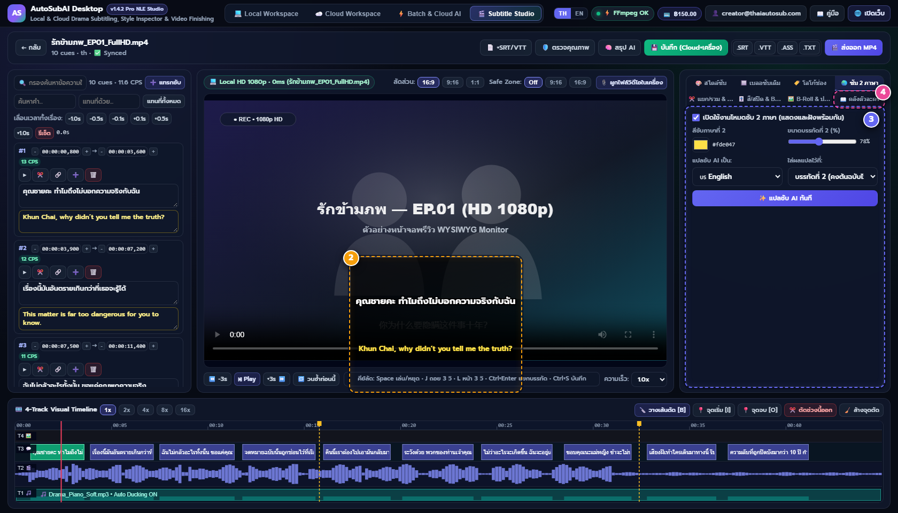

- Edit primary & secondary subtitle lines simultaneously with independent font size/color styling.
- Translate entire episodes in **1 click** while preserving every timestamp.
- Save recurring series character names/terms in **📖 Series Glossary** and run **1-Click Auto-Fix Whole Episode** across every EP.

---

## 7. Pro Split / Merge (Razor + Smart Snap), Demux & 9:16 Viral Shorts

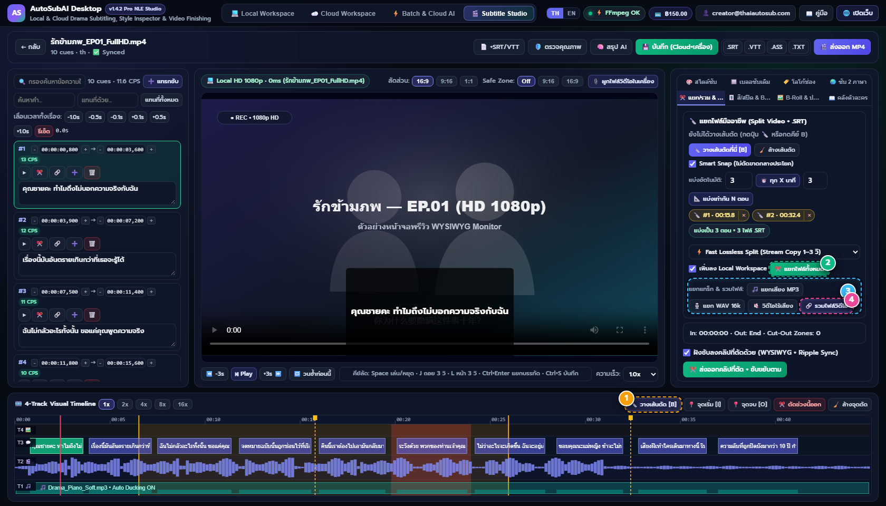

- **🔪 Razor Split `[B]` + Smart Snap**: Drop split markers or auto-split by minutes/parts without cutting mid-sentence.
- **⚡ Fast Lossless Split (1–3s)**: Exports `Part_01..N.mp4` + timecode-reset `.SRT` (`00:00:00`) instantly.
- **🎵 Demux & 📱 9:16 Viral Shorts**: Extract `.MP3`/`16kHz .WAV`/muted MP4 or render vertical `1080×1920` blurred-background clips with bold headlines.

---

## 8. Color Grading, 0.5x–2.0x Speed & BGM Auto Audio Ducking

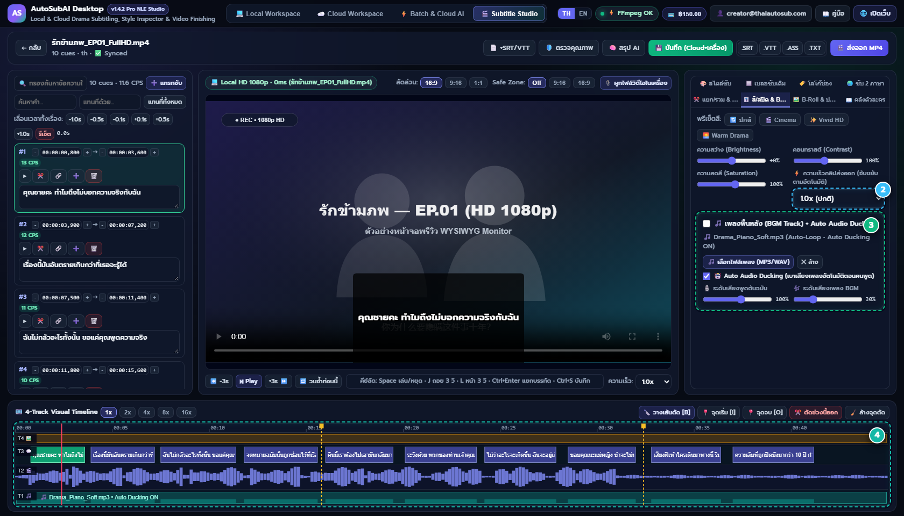

- Adjust Brightness, Contrast, Saturation or apply `Cinema`, `Vivid HD`, `Warm Drama` presets.
- Scale export speed (`0.5x–2.0x`) with automatic lip-sync subtitle rescaling.
- Add looping `.MP3`/`.WAV` background music with FFmpeg `sidechaincompress` **Auto Audio Ducking**.

---

## 9. 🎙️ Live Voiceover, 🗣️ Free AI Text-to-Voice Dubbing & 🎧 `T3/T2/T1` Solo/Mute

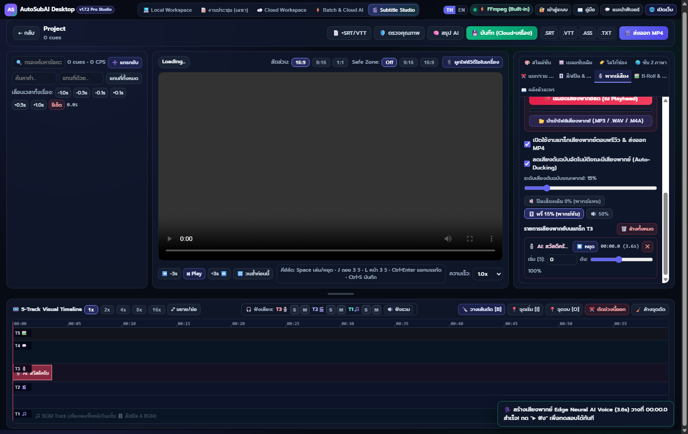

1. **🗣️ Free AI Voiceover (Text-to-Voice — 0% Server Load, Zero Credits)**:
   - Open the **`🎙️ Voiceover`** tab in the right Inspector.
   - Choose from **8 AI Neural Voices** (🇹🇭 Thai Female `Premwadee` / Male `Niwat`, 🇺🇸 English, 🇨🇳 Chinese, 🇯🇵 Japanese, 🇰🇷 Korean) powered by Edge Neural v2 + automatic Google TTS fallback.
   - Type custom text or click **`📋 Pull Active Cue`**, adjust speed/pitch, and click **`🗣️ Generate AI Voiceover (at Playhead)`**.
2. **🎬 1-Click Auto-Dub Entire Video (`Auto Time-Fit`)**:
   - Click **`🎬 Auto-Dub Entire Video from Subtitles (1-Click)`** to synthesize every subtitle line onto Track `T3` with automatic duration fitting.
   - Use quick original-audio ducking presets: **`🔇 Mute Original 0% (Replace)`**, **`🎚️ Duck 15% (Dub Over)`**, or **`🔊 50%`**.
3. **🔴 Live Mic Dubbing & ▶️ 1-Click Audition**:
   - Record live microphone voiceovers with a real-time VU meter or import `.MP3/.WAV/.M4A`, and click **`▶ Play`** on any clip in Track `T3` to audition instantly.
4. **🎧 5-Track Independent Audio Monitor (`Solo [S]` / `Mute [M]`)**:

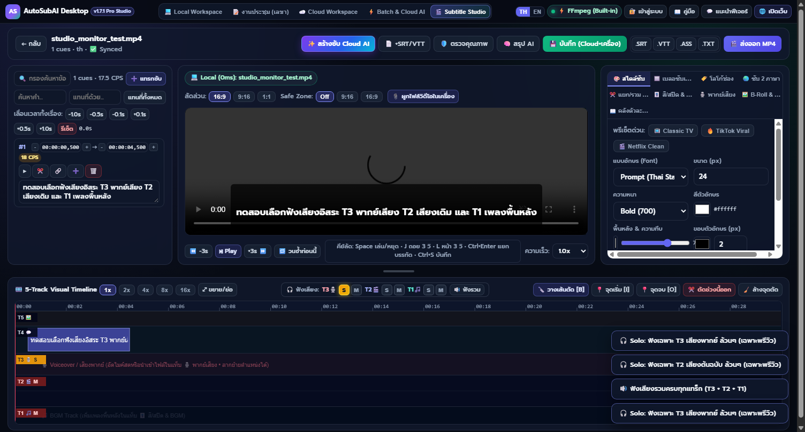

   - Use **`🎧 Monitor: T3 🎙️ [S][M] • T2 🎬 [S][M] • T1 🎵 [S][M] • [🔊 Mix All]`** on the 5-Track Toolbar to solo or mute individual tracks while previewing (**Preview-Only** — never affects your final MP4 export mix!).

---

## 10. 📝 Meeting Minutes (Secretary Mode) — 100% Offline Built-in Confidentiality & Word/LINE Export

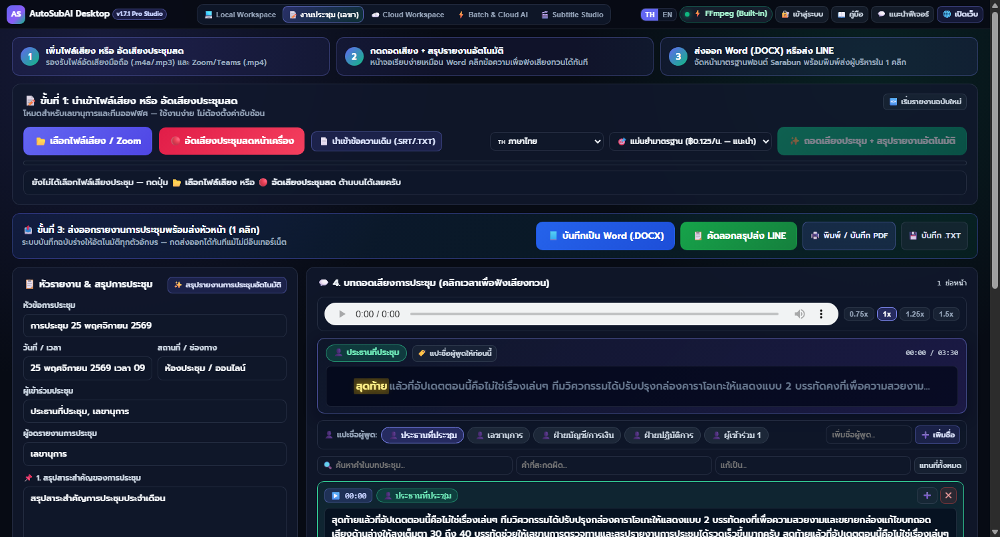

1. **100% Local-Only Confidential Project Archive**: All meetings, minutes, decisions, and speaker lists are stored strictly on your computer's local disk with full-text search, `.JSON` backup/restore, and 1-click **Clone Speaker Template** for recurring meetings.
2. **Import or Record Live**: Import phone recordings (`.m4a/.mp3`), Zoom/Teams (`.mp4`), record live via **`🔴 Record Live Meeting Audio`**, or import existing `.SRT/.TXT`.
3. **Choose Built-in 100% Offline Confidentiality Mode or Cloud AI**:
   - **💻 Built-in Model (Free — 0 Credits • 100% Offline)**: Both transcription and meeting-minutes summary run **100% locally on your PC — zero audio or text ever leaves your machine** (unlimited files, `60m/file` Free/PAYG or `180m/file` Creator/Pro).
   - **☁️ Cloud AI (`Plan 1` / `Plan 2` / `Plan 3`)**: Recommended for echoey rooms or executive proofreading (`Plan 3` unlocks automatically upon credit top-up).
4. **2-Line Rolling Karaoke Stage + 1-Click Speaker Tagger**: Follow spoken words highlighted in real time inside a fixed 2-line teleprompter box, click **`🏷️ Tag Speaker for This Segment`**, and review/edit inside the tall 30–40 line transcript editor.
5. **1-Click Export**: **`📘 Save as Word (.DOCX)`** (Sarabun standard formatting), **`📋 Copy Summary for LINE`**, **`🖨️ Print / Save PDF`**, or **`💾 Save .TXT`** — works even offline!

---

## 11. Photo B-Roll / PiP, 1-Click Viral Thumbnail Maker & MP4 Export

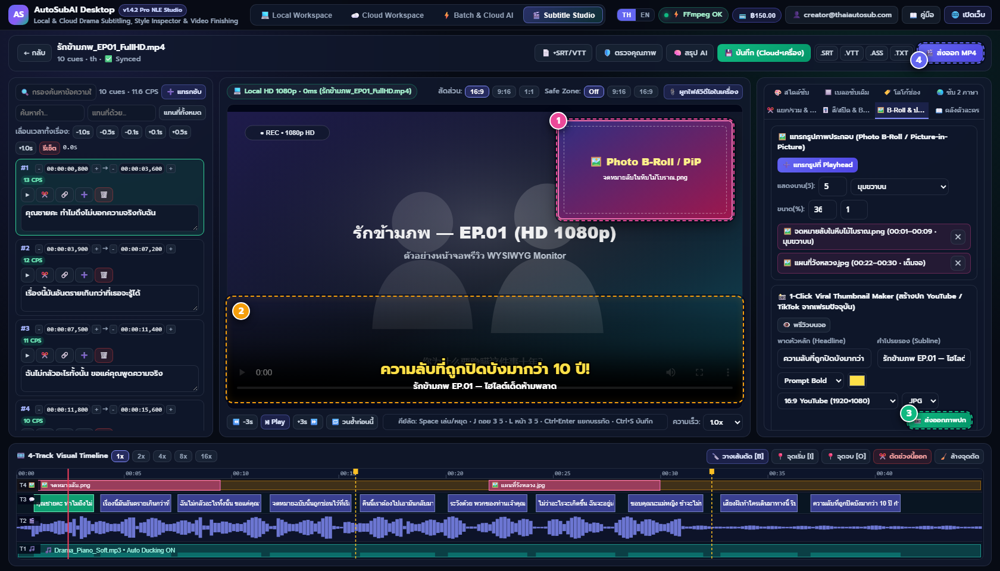

- Insert timed Photo B-Roll overlays on Track `T5` (`Top-Right`, `Top-Left`, `Center`, `Fullscreen`).
- Preview headlines directly over your video frame and export **1920×1080 (YouTube)** or **1080×1920 (TikTok)** `.JPG`/`.PNG` thumbnails in 1 click.
- Export **Hardsub MP4** (all styles, voiceover `T3`, BGM `T1`, B-Roll & watermark baked in) or 1–2s **Softsub MP4** completely free locally!

---

## 12. Keyboard Shortcuts

| Shortcut | Action in Subtitle Studio |
| :--- | :--- |
| `Space` | Play / Pause video |
| `J` / `L` | Seek back 3s / Seek forward 3s |
| `B` | Drop golden **Razor Split Marker** at Playhead |
| `I` / `O` | Set In / Out points on timeline |
| `Ctrl + Enter` | Split active subtitle cue into 2 cues |
| `Ctrl + S` | Save subtitles (Cloud + local `.SRT`) |
| Drag blocks on **T4** / **T3** | Adjust subtitle timing (`T4`) or move voiceover clips (`T3`) on the 5-Track Timeline |
